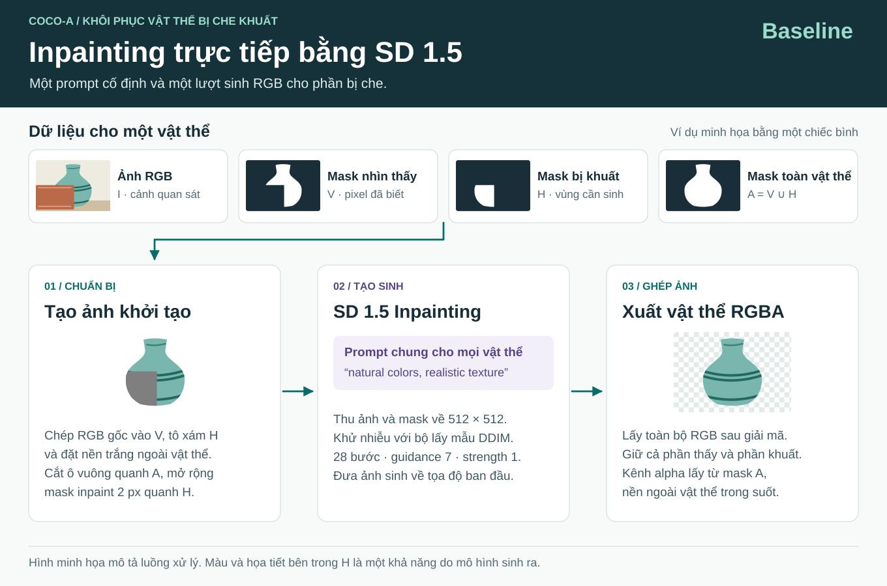

# Baseline

SD 1.5 nhận ROI 512 × 512 chứa RGB nhìn thấy, vùng khuất tô xám và nền trắng. Prompt cố định dùng chung cho mọi vật thể. Cấu hình mặc định chạy DDIM 28 bước, guidance 7, strength 1 và seed 42. Sau khi đưa toàn bộ ROI đã giải mã về tọa độ gốc, pipeline gắn mask amodal làm alpha.

