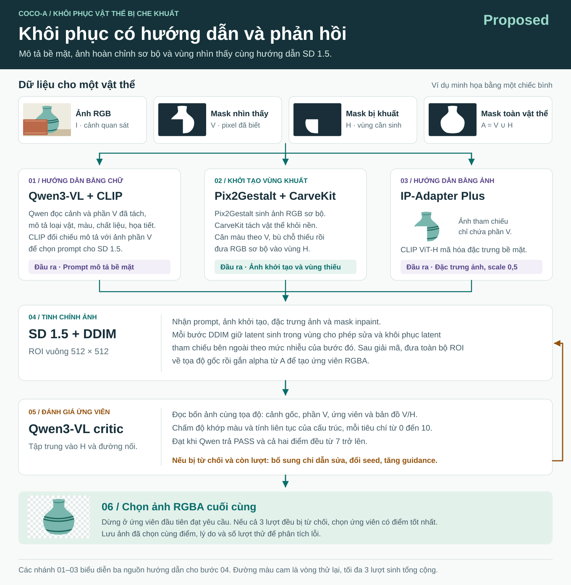

# Proposed

- Qwen3-VL đọc crop ngữ cảnh và crop chỉ chứa phần thấy được, trả JSON
  `object_class`, `primary_color`, `secondary_colors`, `material_and_texture`, `sd_prompt`.
- Pix2Gestalt và CarveKit cung cấp ảnh khởi tạo. CLIP kiểm tra prompt với crop nhìn thấy.
- [IP-Adapter Plus](https://huggingface.co/h94/IP-Adapter) dùng CLIP ViT-H mã hóa
  crop visible trên nền trắng; scale mặc định 0,5. Latent blending tham chiếu
  trạng thái đúng mức nhiễu ở mỗi bước DDIM, không đưa RGB vật che vào phần cần sinh.
- Sau giải mã, pipeline chiếu RGB của cả ROI về ảnh gốc và gắn alpha từ mask. Critic chấm riêng `color_match` và `structure_continuity`. Cả hai điểm phải
  đạt ngưỡng và model phải trả PASS; JSON không hợp lệ được ghi là REJECT sau
  khi thử sửa định dạng. Nếu bị từ chối, đổi seed, tăng guidance 0,5 và thêm
  phản hồi vào prompt. Có tối đa 3 lần sinh tổng cộng. Nếu hết lượt, giữ ứng
  viên có điểm hợp lệ tốt nhất và ghi `exhausted_retries`.

`critic_logs.jsonl` lưu quyết định từng lượt. Kết quả đã sinh có thể REJECT.

